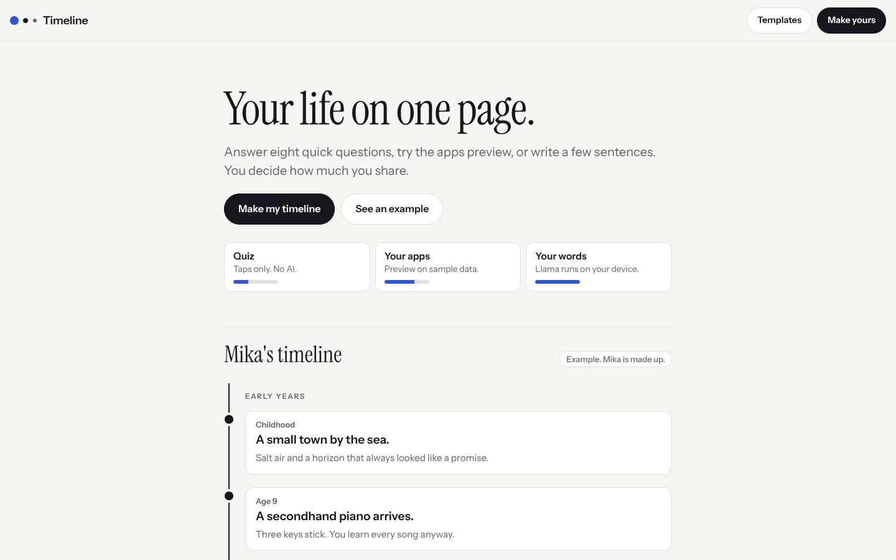
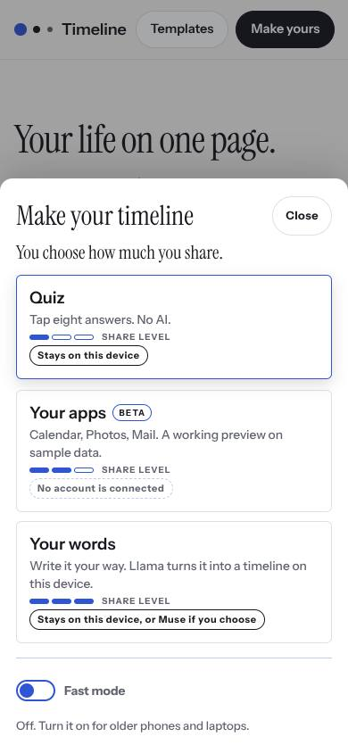
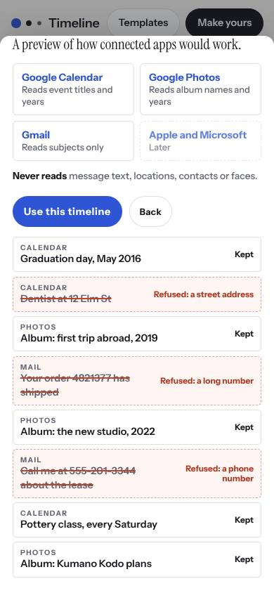
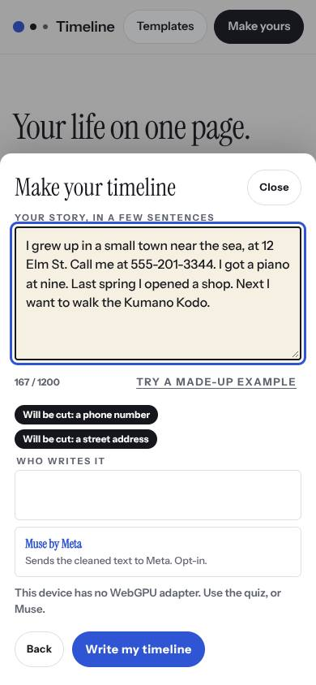
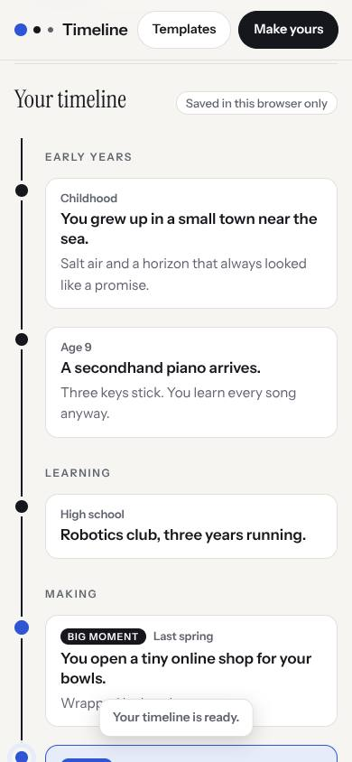
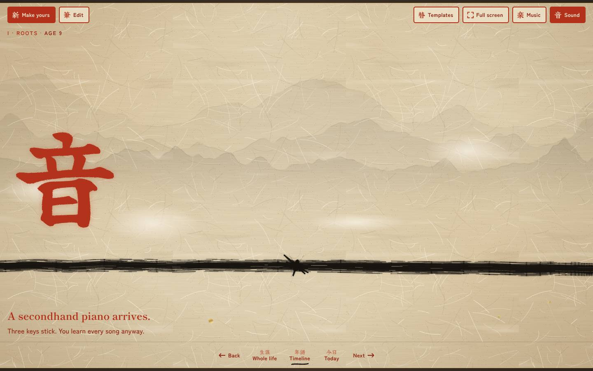
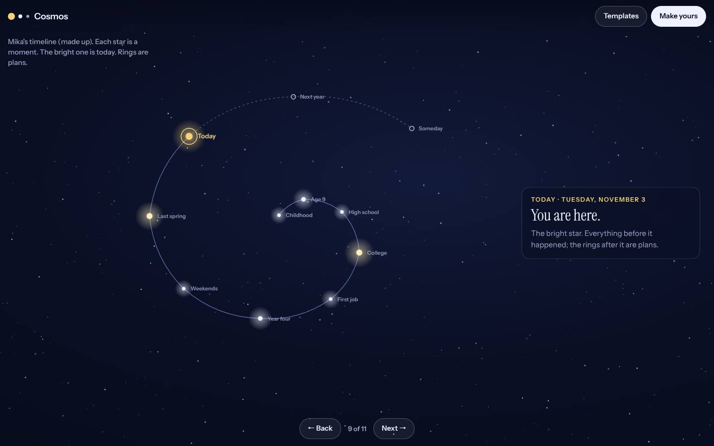

# Timeline

Your life on one page. You choose how much you share. Built with Llama for the Meta Global AI Developer Hackathon (Oct 26 to Nov 4, 2026), Indie track.



<p>




</p>

## Three templates, one timeline

It opens on **Basic**: a plain list anyone can read in seconds. The same timeline can switch to two richer looks at any time.

| Basic | Ink scroll | Cosmos |
|---|---|---|
| A clean vertical list. Today is marked, plans are dotted. | A brush stroke you travel along, with generated music and a fortune for each plan. | Every moment is a star, spiralling out to today. Rings are plans. |




You choose how much you share, in three tiers:

| Tier | What you give | Where it goes |
|---|---|---|
| Quiz | Eight taps. No typing, no AI. | Stays on your device |
| Your apps (beta) | A working preview on sample data: Calendar, Photos and Mail titles run through the real guard | Framework only. No account is connected |
| Your words | A few sentences | **Llama 3.2 1B runs on your device** through WebLLM on WebGPU. Or, opt-in, Muse Spark through Meta's Model API |

## What protects the site and the person

- `src/guard.js` runs in the browser and again on the server. It cuts links, HTML and code, emails, phone numbers, street addresses, postal codes, ID, card and account numbers, exact dates, handles and anything that looks like a password or key. Years stay. The person sees each cut before anything runs.
- Every line a model writes goes through the same guard and a strict shape check: 16 moments at most, length caps, one or two real kanji, known chapters only. Anything that fails is dropped and counted.
- Text is always rendered as text, never as HTML. The server sends a strict Content Security Policy.
- Nothing is stored on a server. The timeline lives in the visitor's browser. The Muse route keeps no logs of what people write and is rate limited (4 a minute, 30 a day per visitor, 600 a day for the site).

## Fast mode

For older phones and laptops: lower canvas resolution, no ink bleed, mist, parallax or flying splatter, and the mountains are baked once into one half-size bitmap. The per-pixel work (paper grain, the mountain wash) is a small Rust library compiled to WebAssembly (`rust/ink`). The Sound sheet has a button that races it against the same code in JavaScript on your device.

## How it's built

```
src/guard.js     the input and output guard (browser and server)
src/gen.js       quiz, kanji picker, omikuji deck, the prompt both models use
src/maker.js     the three tiers, WebLLM in a worker, the Muse client
src/tpl.*        the Basic and Cosmos templates and the template picker
src/fast.js      fast mode and the Rust ink module loader
src/base-*       the ink scroll: brush, splatter, mountains, music, fortunes
rust/ink         per-pixel paper grain and mountain wash, compiled to WebAssembly
server/server.js static files, strict headers, the opt-in Muse route; no dependencies
build.py         builds web/index.html from src/
```

## Run it

```
npm start            # http://localhost:8080, no install needed
npm test             # guard, generator, Muse route and server
python3 build.py     # rebuild web/index.html from src/
```

Rebuild the Rust module:

```
cd rust/ink && RUSTFLAGS="-C target-feature=+simd128" cargo build --release --target wasm32-unknown-unknown && cp target/wasm32-unknown-unknown/release/ink.wasm ../../web/
```

Set `MODEL_API_KEY` (your Meta Model API key) on the host to switch on the Muse writer. Without it the site runs fully, and the Muse button says it's off.

## Credits

Meta Llama 3.2 1B Instruct (Llama 3.2 Community License) through WebLLM by the MLC team (Apache 2.0). Muse Spark through Meta's Model API. Type: Yuji Syuku, Shippori Mincho and Zen Kaku Gothic New via Google Fonts. Futures follow omikuji, the fortune slips of Japanese shrines and temples. Sound is generated live with the Web Audio API.
