<p align="center">
  <picture>
    <source media="(prefers-color-scheme: dark)" srcset="docs/brand/banner-dark.svg">
    
  </picture>
</p>

<br>

<p align="center">
  Where you began. Where you are. What is still ahead.<br>
  <sub>Kept on one page, with only as much of you as you choose to give.</sub>
</p>

<br>

<p align="center">
  <picture>
    <source media="(prefers-color-scheme: dark)" srcset="docs/brand/three-dark.png">
    
  </picture>
</p>

<br>

<p align="center">
  <sub>BUILT WITH META LLAMA&nbsp;&nbsp;&middot;&nbsp;&nbsp;IT STAYS ON YOUR DEVICE</sub>
</p>

<br>

<details>
<summary><sub>Run it</sub></summary>
<br>

```
npm start
```

Then open http://localhost:8080. Nothing to install.

</details>

<details>
<summary><sub>Credits</sub></summary>
<br>

<sub>Meta Llama 3.2 (Llama 3.2 Community License) through WebLLM by the MLC team (Apache 2.0). Muse Spark through Meta's Model API. Type by Instrument, Yuji Syuku, Shippori Mincho and Zen Kaku Gothic New (SIL Open Font License). Made by Ryo N-D for the Meta Global AI Developer Hackathon, 2026.</sub>

</details>

<br>

<p align="center"><sub>MIT License</sub></p>
