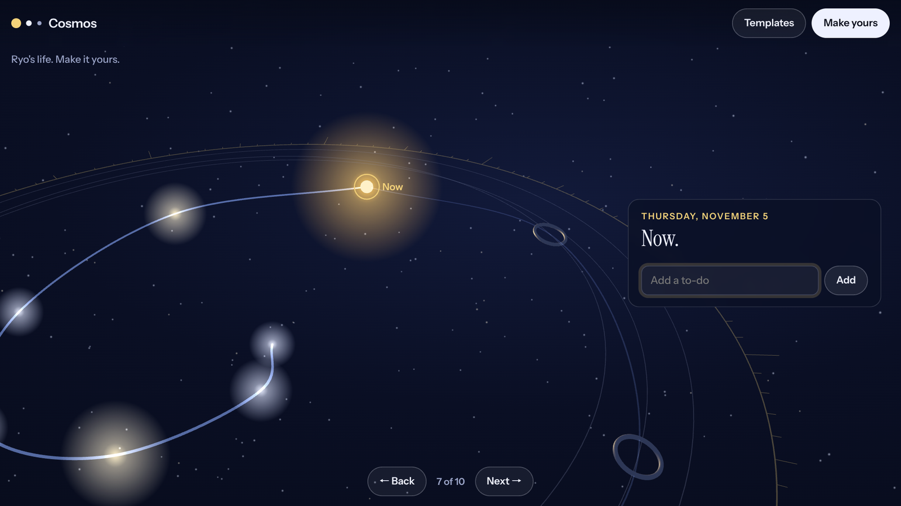
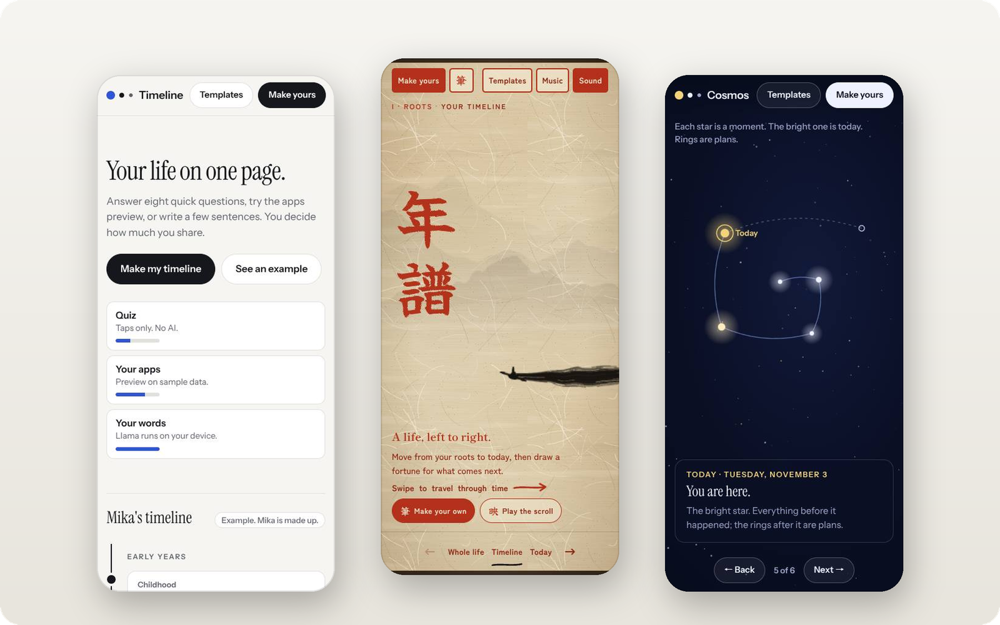

<p align="center">
  <br>
  <picture>
    <source media="(prefers-color-scheme: dark)" srcset="docs/brand/wordmark-dark.svg">
    
  </picture>
  <br>
  <br>
</p>

<p align="center">
  Your life, on one page. Only as much of it as you choose to share.
</p>

<p align="center">
  <sub><a href="https://timeline-11qo.onrender.com">Open Timeline</a>&nbsp;&nbsp;&middot;&nbsp;&nbsp;<a href="https://timeline-11qo.onrender.com/?demo">Watch it play itself</a>&nbsp;&nbsp;&middot;&nbsp;&nbsp;Built with Meta Llama&nbsp;&nbsp;&middot;&nbsp;&nbsp;<a href="LICENSE">MIT License</a></sub>
</p>

<br>

<p align="center">
  
</p>

<p align="center">
  <sub><i>Every moment a star. The bright one is now. The rings are plans.</i></sub>
</p>

<br>

## One life, three skins

**Cosmos** spirals your life out to today, inside a slowly turning star chart. **Ink scroll** is a handscroll drawn live, with brush, splatter and generated koto music. **Basic** is a plain list anyone can read in seconds. Switching keeps your timeline.

<p align="center">
  <picture>
    <source media="(prefers-color-scheme: dark)" srcset="docs/brand/three-dark.png">
    
  </picture>
</p>

## Make yours

- **Write a few sentences.** Meta Llama 3.2 1B turns them into your timeline in the browser, on WebGPU. Without WebGPU, a simple writer on the page stands in.
- **Or ask Meta AI.** One tap copies a ready prompt and opens Meta AI. It asks you a few questions, you paste its reply back, and Timeline builds from it.

Open it and Ryo's own life is the example, so there is something to explore before you write a word.

One guard file runs in the browser and on the server. It cuts links, emails, phone numbers, street addresses, ID and card numbers before any model runs, and re-checks every line a model writes.

## Every day

Today's to-dos live inside your timeline, in every skin. Strike one off and it pays you back: an ensō in Ink, a flare from the gold star in Cosmos. Every plan can draw a fortune. A good one lights up, a bad one dims and shudders, and each comes with one small step you can add to today.

## Private by design

Your timeline is kept only in your browser, and nothing you write is stored on a server. Open the site with `?demo` and it plays its own tour, with a meter counting every network request from the moment it starts.

## Run

```sh
npm start
```

Open `localhost:8080`. Nothing to install. Set `MODEL_API_KEY` to switch on Muse.

## Credits

Meta Llama 3.2 under the Llama 3.2 Community License, through WebLLM by the MLC team (Apache 2.0). Paper grain and fast-mode mountains by a small Rust library compiled to WebAssembly. Type by Instrument, Yuji Syuku, Shippori Mincho and Zen Kaku Gothic New, through Google Fonts (SIL Open Font License). Fortunes after omikuji, the slips of Japanese shrines and temples.

Made by Ryo N-D for the Meta Global AI Developer Hackathon, 2026.
